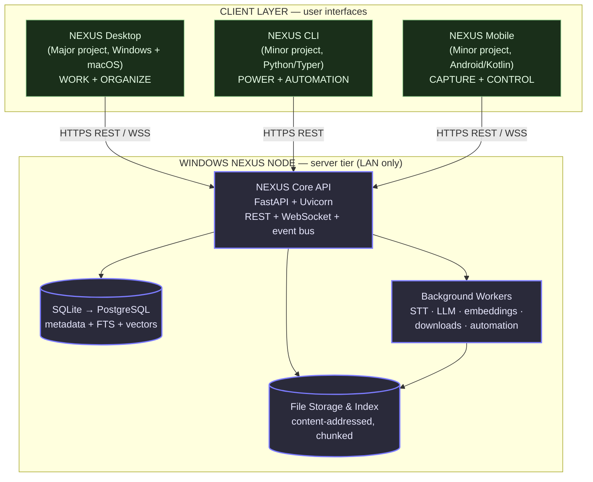
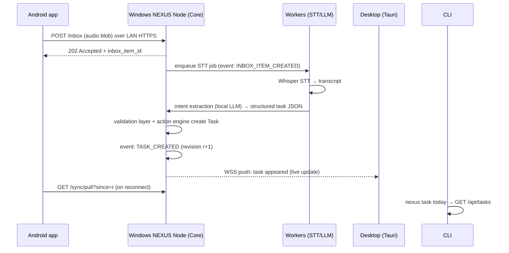
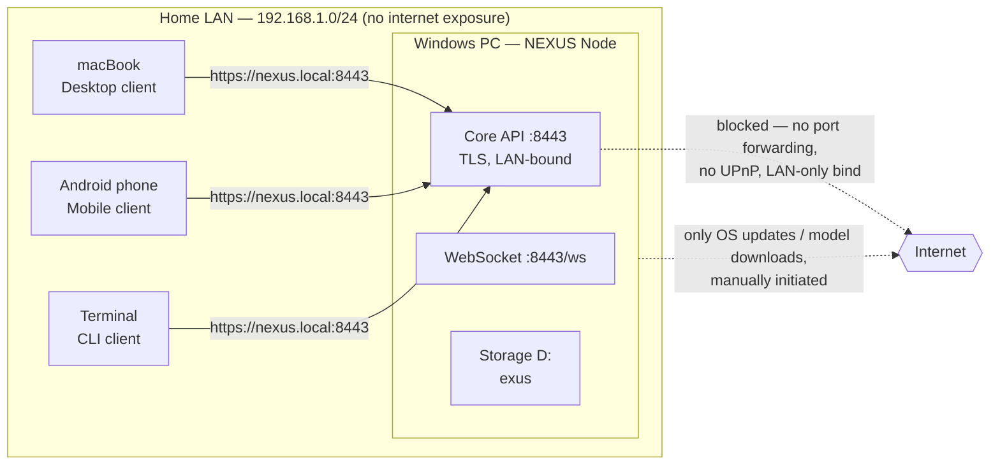

# NEXUS — Optimized Architecture Plan

> Cross-platform personal digital infrastructure synchronizing Windows, macOS, and Android through a Windows-hosted NEXUS Node. All processing stays on the local network; no data leaves the user's network zone.

---

## 1. High-Level System Overview

The optimized architecture keeps the existing hub-and-spoke topology but clarifies the layering that the original Initiation diagram blurred. The Windows Node is not a fourth client sitting beside CLI and Mobile — it is the **server tier itself**, hosting the NEXUS Core. Clients are pure consumers of its API.

**Design principles carried over from the source documents** (all five proposals and the repository):

- One ecosystem, three interfaces: all clients speak the **same API and data model**; a task created anywhere appears everywhere without duplication.
- The Windows machine is the brain and infrastructure node — API host, database, storage, sync coordinator, local AI host, device registry, auth point.
- Capability-based device model: devices declare what they can do (`gpu`, `microphone`, `notifications`...), the Core reasons over capabilities, not device names.
- AI proposes structured intents; **deterministic, validated action engines** execute them — the LLM never touches the filesystem or shell directly.
- Build order: Windows Node → Core API → Desktop → CLI → Android → AI/Media/Automation. The repository already implements steps 1–5 for the Node+CLI slice (with mock auth).

### What the repository already establishes

The current `kn1ght073/nexus` repo is monorepo-shaped exactly as the Initiation plan prescribes: `apps/cli` (Python, Typer + Rich + requests + a Textual full-screen TUI, packaged via `pyproject.toml` as the `nexus` command), `services/core-api` (FastAPI + SQLAlchemy + SQLite; entities User, Device, Project, Task, Note; `/health`, auth/devices/projects/tasks/notes endpoints, plus file browse and text-search endpoints), and `docs/` (architecture, proposals, plans). This structure is preserved and extended below.

---

## 2. Component Breakdown

### 2.1 NEXUS Core (basic core handling component) — `services/core-api`

The heart of the system, running on the Windows server:

- **API layer** (`api.py` → split into `routers/`): REST for CRUD and commands, WebSocket channel for real-time events (task created, download finished, device online).
- **Domain services**: projects, tasks, notes, files, devices, activity — one module each, owning their entities and emitting domain events (`TASK_CREATED`, `FILE_CLASSIFIED`, `DEVICE_ONLINE`).
- **Sync engine**: versioned change-log (`updated_at`, `deleted_at`, `revision`) exposed via `POST /sync/pull` and `POST /sync/push`; clients keep a small local cache (mobile offline capture) and reconcile by revision + last-writer-wins with tombstones. Metadata sync (small, frequent) is separated from file sync (chunked, checksummed, resumable) exactly as the Infrastructure doc specifies.
- **Event bus**: in-process pub/sub for the MVP (FastAPI background tasks), later a lightweight broker if needed; every event fan-outs to indexer, AI classifier, activity logger, automation engine.
- **Auth & device registry**: real token auth replacing the current mock (see errors file), per-device permission scopes, challenge-response registration with public-key device identity.
- **Action engine**: validates AI-derived structured intents against the permission model and an action registry before executing transfers, backups, or commands.

### 2.2 Desktop app (Major project) — `apps/desktop`

Primary rich client for Windows, designed for macOS parity (Section 7). Tauri 2 shell with a React + TypeScript frontend; talks REST + WebSocket to the Core running on the same machine or another LAN host. Modules mirror the eight product components: Dashboard, Projects/Tasks/Notes, Universal Inbox, Files, Search, Devices, Media, Downloads, Automation, Utilities, Activity Timeline. Because it is a web-frontend client, the desktop app can also open a WebSocket to mirror live activity and accept remote actions (it registers as a device with `filesystem` capability when the Core runs on the same PC).

### 2.3 CLI (Minor project 1) — `apps/cli` (existing, preserved)

Python Typer + Rich + requests, with the Textual TUI (`nexus ui`). Already implements `init/status/project/task/note/file list/search`. The plan preserves this structure and extends it in-place: add `nexus devices`, `nexus task today`, `nexus sync`, `--json` output for pipelines, and (post-MVP) `media`, `automation`, and `ai` command groups. The CLI always goes through the Core API — never the database directly.

### 2.4 Mobile app (Minor project 2) — `apps/mobile`

Kotlin + Jetpack Compose Android client. Quick capture (text, voice, camera), universal inbox, task/project browsing, file upload, notifications (WebSocket + FCM-free local push via foreground service on LAN), device status, media streaming. Offline-friendly: Room cache of projects/tasks/notes, background sync on reconnect, voice notes recorded locally and uploaded as jobs for the Node's STT.

---

## 3. Data Flow & Synchronization

The flagship scenario (voice note → task on every device) exercises every mechanism:

**Three sync planes** (from the Infrastructure doc): *metadata sync* (tasks/notes/projects — small, frequent, revision-based); *file sync* (chunked upload/download with SHA-256 per chunk, resumable, deduplicated by content hash); *event sync* (WebSocket fan-out + pull fallback). Conflict policy: single-writer UI state, last-writer-wins on metadata with revision check, tombstones for deletes; the Core is the single source of truth so clients never write to each other directly.

---

## 4. Technology Stack Recommendations

| Layer | Choice | Why (local-network, cross-platform constraints) |
|---|---|---|
| Core API | Python 3.11+ / FastAPI + Uvicorn | Already in repo; local AI/ML (Whisper, embeddings) is Python-native; runs on Windows as a service and on macOS unchanged. |
| Database | SQLite (WAL) now → PostgreSQL later | Repo uses SQLite; zero-ops single-node. Add SQLite FTS5 for full-text + sqlite-vec/LanceDB for vectors before considering Postgres+pgvector. |
| Real-time | WebSocket (FastAPI `websockets`) | LAN push of events; no external broker, no cloud push service. |
| Local AI | faster-whisper (STT), Ollama (local LLM), sentence-transformers or bge-m3 (embeddings) | Fully offline models; Ollama runs on Windows/macOS with GPU or CPU. |
| Desktop | Tauri 2 + React + TypeScript + Tailwind | Small binaries, native webview, one codebase for Windows + macOS; Rust backend gives filesystem/tray/notification APIs. |
| Mobile | Kotlin + Jetpack Compose, Room, OkHttp/Retrofit | Modern Android standard; works against plain LAN HTTPS without Google services. |
| CLI | Python Typer + Rich (+ existing Textual TUI) | Preserve existing structure; Typer sub-app pattern already matches `project/task/note` groups. |
| Packaging (Windows) | PyInstaller or NSSM/Task Scheduler service for Core; NSIS/MSI installer for Desktop | Node runs headless at login/boot; no cloud dependency. |
| Discovery | mDNS (`python-zeroconf`) | Clients find `nexus.local` on the LAN without hardcoded IPs. |

The CLI's stack is fixed by the repo (Python), which anchors the Python-centric backend choice: keeping one language across Core, workers, and CLI minimizes context-switching for a solo developer, while Tauri/Kotlin cover the GUI platforms.

---

## 5. Deployment & Networking Layout (local-network only)

- The Core binds to the LAN interface (`--host 0.0.0.0` with Windows Firewall rule scoped to the private profile, port 8443). The current `main.py` binds `127.0.0.1` — fine for dev, must change for deployment (errors file, item E8).
- **TLS on the LAN**: self-signed CA generated on the Node; clients pin the CA cert during pairing. Plain HTTP should never leave `127.0.0.1`.
- **Discovery & pairing**: mDNS advertises `nexus.local`; first connection shows a 6-digit pairing code on the Desktop; the Node issues a device certificate/token with scoped capabilities.
- **Node availability**: Core runs at logon (NSSM service or Task Scheduler); optional Auto-Start so the "always-on brain" premise holds; wake-on-LAN for media/download jobs.
- **Backups**: nightly local snapshots of `nexus.db` + storage manifest to a second disk or NAS on the same LAN — never a cloud target.
- **Model acquisition** is the one intentional outbound exception: downloading Whisper/LLM weights is a manual, user-initiated act, not a runtime dependency of any NEXUS service. After download, all inference is local.

---

## 6. Security & Privacy (no external data transmission)

1. **Real authentication**: replace `mock-token-123` and the auto-created user with Argon2id-hashed passwords + JWT access/refresh tokens; per-device tokens with scopes (read, capture, transfer, media, automation, admin).
2. **Least privilege per device**: Android → read projects, create tasks/notes, upload, request transfer, media playback; CLI → search, project management, automation; Desktop → full control. The capability model from the docs becomes enforcement, not documentation.
3. **Transport**: TLS 1.3 on LAN with CA pinning; tokens never stored in world-readable files; CLI config gains a keyring-backed token store instead of plain `~/.nexus-cli.json`.
4. **File endpoints are the biggest attack surface**: the current `/files/browse` and `/files/search` walk the whole home directory and read any file ≤1 MB. The plan jails them behind a configurable allowlist of root directories (`storage.roots`), resolves and rejects path traversal (`..`, symlinks), and rate-limits walk depth. Device-to-device transfers go through the Node, which applies the permission model.
5. **AI safety**: LLM output is parsed to a strict intent schema (JSON Schema validation); the action engine verifies permissions, resolves entities to real IDs, and requires confirmation for destructive/destructive-adjacent actions. No LLM-generated shell commands, ever.
6. **Audit & privacy**: append-only audit log for transfers, logins, remote commands, AI actions. Activity timeline stays opt-in and disableable per the Infrastructure doc. Telemetry: none. Crash reporting: none. All logs stay on the Node.
7. **Network posture**: no port forwarding, no UPnP, no dynamic-DNS; LAN-only bind; Windows Firewall scoped to the private profile; router has no NEXUS exposure.
8. **Data at rest**: optional SQLCipher for the database and per-file encryption keys for sensitive vault files; secrets in Windows Credential Manager / macOS Keychain (which also feeds Section 7 parity).

---

## 7. macOS Compatibility Notes

Although only the Windows desktop app will be submitted, the architecture keeps macOS a first-class client and potential future Node host:

- **Stack parity**: Tauri 2 targets Windows and macOS from one codebase; Rust backend handles tray, notifications, filesystem, and auto-start on both. Kotlin Android is unaffected.
- **Python Core is cross-platform**: FastAPI/Uvicorn/SQLAlchemy/SQLite run unchanged on macOS; only service management differs (launchd `LaunchAgent` vs NSSM/Task Scheduler) and paths (`~/Library/Application Support/nexus` vs `%APPDATA%\nexus`).
- **macOS as a Node**: capability flags exist in the device model (`gpu`, `llm_inference`, `media_server`); a MacBook can register with inference capabilities, but the sync engine keeps the Windows Node authoritative. Promotion of a Mac to Node is a config flag, not a rewrite.
- **iOS is explicitly out of scope** (the docs target Android only), but the REST/WSS client design would port to SwiftUI with a new client, zero Core changes.
- **macOS quirks to design for now**: App Sandbox + TCC prompts for file access (the storage allowlist maps cleanly to macOS security-scoped bookmarks); Keychain for tokens; universal clipboard stays NEXUS-internal rather than hooking macOS pasteboard daemons; `nexus.local` mDNS works natively via Bonjour.

---

## 8. Implementation Roadmap (delta from current repo)

1. **Harden the Node** (security file items): real auth, ownership-filtered queries, path-jailed file endpoints, CORS lock-down, remove `nexus.db.bak` from git.
2. **Extend the Core**: `updated_at/revision/deleted_at` columns + `/sync/pull` `/sync/push`; WebSocket event channel; device registry with capabilities + scopes.
3. **Extend the CLI in place**: `devices`, `sync`, `task today`, `--json`, config token store; keep Typer structure and TUI.
4. **Desktop Tauri shell**: login/pairing, dashboard, projects/tasks/notes, file manager, live event updates.
5. **Mobile**: pairing, capture, tasks, upload, notifications; offline Room cache + background sync.
6. **AI layer**: faster-whisper + Ollama + embeddings behind the validation/action engine; Universal Inbox pipeline.
7. **Media/downloads/automation**: after core ecosystem works, per the build order in the Initiation doc.

The success criterion remains the one the Infrastructure doc defines: capture on Android → structured task on the Node → visible on Windows/macOS desktop → queryable from the CLI, with every action authenticated, permissioned, and auditable — and nothing ever leaving the LAN.
